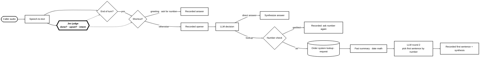
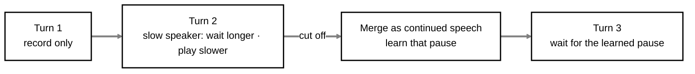
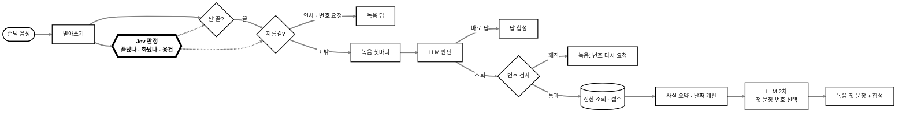

# Haruon Real-Time Voice Agent

> DIRECT:ON 2026 · A real-time voice AI that handles phone support for "Haruon", a health supplement brand

English · [한국어](#하루온-실시간-음성-상담원)

## At a Glance

| First sound (p50) | Answer after lookup (p50) | Speed score | Function score | Barge-ins |
|:---:|:---:|:---:|:---:|:---:|
| **1.09 s** | **1.43 s** | **98.6** | **92.9** | **0** |
| full marks ≤ 1.5 s | full marks ≤ 3.5 s | /100 | /100 | 28 cases |

<sub>28 practice cases · 4 concurrent · real models via the gateway</sub>

| Role | Model | Gateway path | Measured |
|---|---|---|---|
| Speech-to-text | Soniox real-time | `/soniox/transcribe-websocket` | connect 70 ms |
| Reasoning | GPT-5.4 mini | `/chat/completions/` | decision ~1.5 s |
| Voice | Gemini 3.8 Flash TTS | `/audio/speech/` | no streaming, ~3 s per sentence |
| Turn judge | Jev `jev-1.14.0` | `/decisions/` | 0.4–0.6 s |

---

## Overall Flow



"Recorded" = pre-synthesized audio (plays instantly) · thick border = Jev turn judge · gray dotted line = Jev result used as a hint

---

## Timeline of One Turn

| After end of speech | Measurement mode (scoring) | What happens |
|:---:|---|---|
| 0 s | Caller stops speaking | |
| 0.45 s | Ask Jev | done? · upset? · intent |
| 1.0 s | End of turn confirmed | for a sentence ending in punctuation |
| **1.1 s** | **First sound** | recorded opener or fixed answer |
| 2.5 s | LLM decision | answer directly / call a function |
| 3.3 s | Lookup result | evaluator relay adds 0.8–1.5 s |
| **4.7 s** | **Answer after lookup** | 1.4 s after the result, recorded first sentence |

---

## Paths by Question Type

| Path | Example | Jev | First sound | Actual answer |
|---|---|:---:|:---:|:---:|
| Greeting only | "Hello?" | not used | 1.6 s | = first sound |
| Lookup request without a number | "When will my order arrive?" | used | 1.0 s | = first sound |
| General question | "Can I return it if it doesn't work?" | used | 1.1 s | 5–6 s |
| Needs a lookup | "My order under 010-xxxx-xxxx" | used | 1.1 s | 1.4 s after result |
| Garbled number | "zero one zero… seven seven…" | used | 1.1 s | ask number again |
| No Jev response | (any question) | none | 1.1 s | only skips shortcuts |

---

## End-of-Turn Rules

| How the transcript ends | Measure | Demo | Why |
|---|:---:|:---:|---|
| Punctuation `.` `?` | 1.0 s | 0.8 s | finished sentence |
| Ends with a noun ("Shipping question.") | 2.0 s | 1.0 s | may continue |
| Reading a number ("010 1234.") | 1.6 s | 1.6 s | digits missing |
| Connective ending ("I ordered, but…") | 2.0 s | 2.0 s | will continue |
| Greeting / preamble ("Hello.") | 1.6 s | 1.6 s | main request follows |
| Comma / ellipsis ("Gut supplement,") | 2.4 s | 2.4 s | will continue |
| Correcting oneself ("No," "Wait.") | – | 2.5 s | pauses to think |
| No punctuation + Jev | 1.0–2.0 s | 0.8–2.0 s | by Jev completion probability |

> Speaking while the caller is still talking scores 0 for speed on that case, so the waits are conservative.

---

## Where Jev Is Used

| | ① End of turn | ② Shortcut (fixed answer) | ③ Choosing the opener |
|---|---|---|---|
| Question | Finished? | Intent? | Upset? Intent? |
| Rule | completion ≥ 0.5 → 1.0 s<br/>0.25–0.5 → 1.6 s<br/>< 0.25 → 2.0 s | confidence ≥ 0.9 alone<br/>or ≥ 0.55 agreeing with keywords | upset ≥ 0.8 → "Sorry for the trouble"<br/>lookup intent → "Let me check" |
| Without Jev | 1.1 s | not used (except greetings) | chosen by keywords |

---

## Why Pre-Recorded Audio

| Characters | Time to first TTS audio |
|:---:|:---:|
| 9 | 2.96 s |
| 28 | 3.05 s |
| 83 | 5.09 s |

The gateway TTS does not stream, and even a short sentence takes about 3 s. So **123 frequently used sentences are pre-synthesized**, and the LLM chooses which one to play.

| Pre-recorded | Used for |
|---|---|
| Openers (empathy · check · info) | first sound of every answer |
| Fixed answers (greeting, ask for number, how to buy) | answer without the LLM |
| First sentence after lookup ("I checked, it's on the way.") | LLM picks it by number |
| Per-product first sentence ("The product you asked about is …") | after a product search |
| Ask number again ("Please say the 11 digits one by one…") | when the number is garbled |

---

## Safeguards

| Failure prevented | Safeguard |
|---|---|
| Filing a request with a garbled number | 11-digit mobile and order-number format checks, example numbers blocked |
| Number heard slightly wrong | corrected against earlier conversation and caller ID (edit distance 3–4) |
| Lookup returns nothing | retry with other numbers from the conversation |
| Wrong dates in the answer | days elapsed and return window computed in code, answer dates verified |
| "I checked…" without a lookup | sent back once for a new decision |
| "I've filed it" without a successful request | sent back once · replaced if already filed |
| **Return/exchange of a cancelled order** | **request blocked + removed from choices** |
| Wrong recording played ("40,000 won" vs "50,000 won") | recording not used if numbers or negations differ |
| Answer too long | 3 sentences · 130 characters max |

---

## Measurement Mode vs Demo Mode

| | Measurement mode (scoring) | Demo mode (talking with a person) |
|---|---|---|
| Enabled by | default | `"mode": "live"` in `session.start` |
| Conversation | one question | multiple turns |
| Barge-in | – | stops speaking, keeps only what was played in history |
| Cut-off speech | – | merged with the previous words if only the opener was played |
| Run LLM before end of turn | off | on |
| Short FAQ recorded answers | off | 8 kinds |
| Speaking-pace adaptation (pace) | never triggers | slow speakers: wait up to 1.2×, playback 0.85× |



---

## Gateway Constraints

| Constraint | Handling |
|---|---|
| PII filter masks phone numbers and emails | swapped for `{{PHONE_n}}` placeholders and restored |
| Some dates are masked | dates sent in Korean words |
| 120 requests per minute per key | capped at 115 overall, 25 reserved for Jev (`agent/ratelimit.py`) |
| TTS does not stream | pre-synthesis + parallel per-sentence synthesis + early first-sentence synthesis |

---

## Run

```bash
pip install -r requirements.txt
cp .env.example .env                    # one BAZE gateway key for all models
bash start_mock.sh data/mock_db.json    # mock function server :8100
bash start_server.sh                    # agent server :9000
python demo/serve.py                    # demo page http://localhost:8080
```

| Task | Command |
|---|---|
| Unit tests | `python -m unittest tests.test_units -v` |
| Speech-to-text accuracy | `python bench/stt_eval.py` |
| Jev and fixed-answer accuracy | `python bench/jev_eval.py` |
| Response and function scores (no TTS) | `python bench/text_eval.py --stt --judge-model gpt-6-luna` |
| Demo-mode conversation check | `python bench/live_check.py` (`--slow 0.75`: slow caller) |
| Submission ZIP (with audio cache) | `python ops/make_submission.py` |

> Competition data is not committed to the public repository. Copy `data/brand/*`, `data/mock_db.json` and `data/examples.json` from the official materials (`data/README.md`).

---

## Folder Structure

| Path | Role |
|---|---|
| `agent/server.py` | entry point, warms pre-synthesized audio (opens the port first) |
| `agent/session.py` | one call: end of turn → first sound → decision → functions → answer |
| `agent/router.py` | Jev judge, keyword rules, fixed answer and opener choice |
| `agent/brain.py` | prompt assembly, GPT-5.4 mini, PII placeholders |
| `agent/toolflow.py` | checks before and after function calls, retries, answer guards |
| `agent/facts.py` | number correction, lookup summaries, answer verification |
| `agent/aftertool.py` | first-sentence list after a lookup |
| `agent/clips.py` | pre-synthesized sentences and matching rules |
| `agent/pace.py` | pace-adaptive waits and playback speed |
| `agent/tts.py` · `stt.py` | Gemini TTS · Soniox speech-to-text |
| `agent/ratelimit.py` | gateway rate limit |
| `agent/prompts/` | system prompt, policy table, recorded sentence lists |
| `mock_tools/server.py` | mock function server |
| `demo/` | demo page |
| `bench/` · `tests/` | measurement and evaluation tools · unit tests |
| `ops/make_submission.py` | submission ZIP |

<br/>

---
---

<br/>

# 하루온 실시간 음성 상담원

> DIRECT:ON 2026 · 건강기능식품 브랜드 "하루온"의 전화 상담을 맡는 실시간 음성 AI

[English](#haruon-real-time-voice-agent) · 한국어

## 한눈에

| 첫 소리 (p50) | 조회 뒤 답 (p50) | 속도 점수 | 함수 점수 | 끼어들기 |
|:---:|:---:|:---:|:---:|:---:|
| **1.09초** | **1.43초** | **98.6** | **92.9** | **0건** |
| 만점 기준 1.5초 | 만점 기준 3.5초 | /100 | /100 | 28문항 |

<sub>연습 28문항 · 동시 4건 · 실제 모델(게이트웨이) 실측</sub>

| 역할 | 모델 | 게이트웨이 경로 | 실측 |
|---|---|---|---|
| 받아쓰기 | Soniox 실시간 | `/soniox/transcribe-websocket` | 연결 70ms |
| 판단 | GPT-5.4 mini | `/chat/completions/` | 판단 약 1.5초 |
| 목소리 | Gemini 3.8 Flash TTS | `/audio/speech/` | 스트리밍 없음, 문장당 약 3초 |
| 눈치 | Jev `jev-1.14.0` | `/decisions/` | 0.4~0.6초 |

---

## 전체 흐름



"녹음" = 미리 합성해 둔 음성(바로 나감) · 굵은 테두리 = 판정 모델 Jev · 회색 점선 = Jev 판정이 참고로 들어감

---

## 한 턴의 시간표

| 말 끝 뒤 | 측정 모드 (채점) | 일어나는 일 |
|:---:|---|---|
| 0초 | 손님 말이 끝남 | |
| 0.45초 | Jev에 질문 | 끝났나 · 화났나 · 용건 |
| 1.0초 | 말 끝 확정 | 문장부호로 끝난 말 기준 |
| **1.1초** | **첫 소리** | 녹음된 첫마디 또는 고정 답 |
| 2.5초 | LLM 판단 | 바로 답 / 함수 호출 |
| 3.3초 | 조회 결과 | 측정기 중계 0.8~1.5초 |
| **4.7초** | **조회 뒤 답** | 결과 뒤 1.4초, 녹음 첫 문장 |

---

## 질문 종류별 경로

| 경로 | 예 | Jev | 첫 소리 | 실제 답 |
|---|---|:---:|:---:|:---:|
| 인사만 | "여보세요?" | 안 씀 | 1.6초 | = 첫 소리 |
| 번호 없이 조회 요청 | "주문한 거 언제 와요?" | 씀 | 1.0초 | = 첫 소리 |
| 일반 질문 | "먹어 보고 효과 없으면 반품돼요?" | 씀 | 1.1초 | 5~6초 |
| 조회 필요 | "010-○○○○-○○○○로 주문한 거요" | 씀 | 1.1초 | 결과 뒤 1.4초 |
| 번호가 깨짐 | "공일공에… 칠칠…" | 씀 | 1.1초 | 번호 다시 요청 |
| Jev 응답 없음 | (어떤 질문이든) | 없음 | 1.1초 | 지름길만 포기 |

---

## 말 끝 판단

| 받아쓴 말의 끝 | 측정 | 시연 | 이유 |
|---|:---:|:---:|---|
| 문장부호 `.` `?` | 1.0초 | 0.8초 | 끝난 말 |
| 명사로 끝남 "배송 문의." | 2.0초 | 1.0초 | 이어 말할 수 있음 |
| 번호 읽는 중 "010 1234." | 1.6초 | 1.6초 | 자릿수 모자람 |
| 연결어미 "주문했는데." | 2.0초 | 2.0초 | 이어 말함 |
| 인사·서두 "안녕하세요." | 1.6초 | 1.6초 | 본론이 이어짐 |
| 쉼표·말줄임 "대장 영양제," | 2.4초 | 2.4초 | 이어 말함 |
| 말 고치는 중 "아니," "잠깐만요." | – | 2.5초 | 생각하며 쉼 |
| 문장부호 없음 + Jev | 1.0~2.0초 | 0.8~2.0초 | Jev 완결 확률로 |

> 손님이 말하는 도중 소리를 내면 그 문항의 속도 점수는 0점이라, 대기는 보수적으로 잡는다.

---

## Jev가 끼는 세 자리

| | ① 말 끝 판단 | ② 지름길(고정 답) | ③ 첫마디 고르기 |
|---|---|---|---|
| 묻는 것 | 끝났나? | 용건은? | 화났나? 용건은? |
| 기준 | 완결 0.5↑ → 1.0초<br/>0.25~0.5 → 1.6초<br/>0.25↓ → 2.0초 | 확신 0.9↑ 단독<br/>또는 키워드와 같은 판단 0.55↑ | 화남 0.8↑ → "불편을 드려 죄송합니다"<br/>조회 용건 → "확인해 드리겠습니다" |
| Jev가 없으면 | 1.1초 | 쓰지 않음 (인사만 예외) | 키워드로 고름 |

---

## 왜 미리 녹음하나

| 글자 수 | TTS 첫 음성까지 |
|:---:|:---:|
| 9자 | 2.96초 |
| 28자 | 3.05초 |
| 83자 | 5.09초 |

게이트웨이 TTS는 스트리밍이 없고 짧은 문장도 약 3초가 걸린다. 그래서 **자주 쓰는 문장 123개를 미리 합성**해 두고, LLM은 그중 무엇을 낼지 고르게 한다.

| 미리 녹음한 것 | 쓰는 곳 |
|---|---|
| 첫마디 (공감·확인·안내) | 모든 답의 첫 소리 |
| 고정 답 (인사, 번호 요청, 구매 안내) | LLM 없이 바로 답 |
| 조회 뒤 첫 문장 ("확인해 보니 현재 배송 중이에요.") | LLM이 번호로 고름 |
| 제품별 첫 문장 ("문의하신 제품은 ○○입니다.") | 상품 검색 뒤 |
| 번호 다시 요청 ("11자리를 한 자리씩…") | 번호가 깨졌을 때 |

---

## 안전장치

| 막는 사고 | 장치 |
|---|---|
| 깨진 번호로 접수 | 휴대폰 11자리·주문번호 형식 검사, 예시 번호 차단 |
| 비슷하게 들린 번호 | 이전 대화·발신자 번호와 비교해 보정 (편집거리 3~4) |
| 조회가 빔 | 대화 속 다른 번호로 재조회 |
| 날짜를 틀리게 말함 | 경과일·반품 가능 기간을 코드가 계산, 답의 날짜 검증 |
| 조회 없이 "확인해 보니" | 한 번 되돌려 다시 판단 |
| 접수 없이 "접수해 드렸습니다" | 한 번 되돌림 · 이미 접수면 문장 교체 |
| **취소된 주문을 반품·교환** | **접수 차단 + 선택지에서 제외** |
| 녹음 문장 오재생 ("4만 원"↔"5만 원") | 숫자·부정어가 다르면 녹음을 쓰지 않음 |
| 답이 너무 김 | 3문장·130자 제한 |

---

## 측정 모드 vs 시연 모드

| | 측정 모드 (채점) | 시연 모드 (사람과 대화) |
|---|---|---|
| 켜지는 조건 | 기본값 | `session.start`에 `"mode": "live"` |
| 대화 | 질문 하나 | 여러 턴 |
| 끼어들기 | – | 상담원 말을 멈춤, 들려준 데까지만 이력에 남김 |
| 끊긴 말 | – | 첫마디만 나갔으면 앞말과 이어 붙임 |
| 말 끝 전 LLM 미리 실행 | 끔 | 켬 |
| 짧은 FAQ 녹음 답 | 끔 | 8종 |
| 말 속도 맞춤 (pace) | 발동 안 함 | 느린 사람: 대기 최대 1.2배, 재생 0.85배 |


---

## 게이트웨이 대응

| 제약 | 대응 |
|---|---|
| 개인정보 필터가 전화번호·이메일을 가림 | `{{PHONE_n}}` 자리표시로 바꿔 보내고 되돌림 |
| 일부 날짜를 가림 | 날짜를 한글로 바꿔 보냄 |
| 키당 분당 120건 | 전체 115건으로 제한, Jev 몫 25건 따로 (`agent/ratelimit.py`) |
| TTS 스트리밍 없음 | 미리 합성 + 문장 단위 동시 합성 + 첫 문장 미리 합성 |

---

## 실행

```bash
pip install -r requirements.txt
cp .env.example .env                    # BAZE 게이트웨이 키 하나로 모든 모델
bash start_mock.sh data/mock_db.json    # 모의 함수 서버 :8100
bash start_server.sh                    # 상담 서버 :9000
python demo/serve.py                    # 시연 화면 http://localhost:8080
```

| 할 일 | 명령 |
|---|---|
| 단위 시험 | `python -m unittest tests.test_units -v` |
| 받아쓰기 정확도 | `python bench/stt_eval.py` |
| Jev·고정 답 정확도 | `python bench/jev_eval.py` |
| 응대·함수 점수 (TTS 없이) | `python bench/text_eval.py --stt --judge-model gpt-6-luna` |
| 시연 모드 대화 점검 | `python bench/live_check.py` (`--slow 0.75`: 느린 고객) |
| 제출 ZIP (음성 캐시 포함) | `python ops/make_submission.py` |

> 대회 제공 데이터는 공개 저장소에 올리지 않는다. `data/brand/*`, `data/mock_db.json`, `data/examples.json`은 공식 자료에서 복사한다 (`data/README.md`).

---

## 폴더 구조

| 경로 | 역할 |
|---|---|
| `agent/server.py` | 진입점, 미리 합성 음성 예열 (포트를 먼저 연다) |
| `agent/session.py` | 한 통화: 말 끝 판단 → 첫 소리 → 판단 → 함수 → 답 |
| `agent/router.py` | Jev 판정, 키워드 규칙, 고정 답·첫마디 선택 |
| `agent/brain.py` | 프롬프트 조립, GPT-5.4 mini, 개인정보 자리표시 |
| `agent/toolflow.py` | 함수 실행 전후 검사, 재조회, 답 가드 |
| `agent/facts.py` | 번호 보정, 조회 결과 요약, 답 검증 |
| `agent/aftertool.py` | 조회 뒤 첫 문장 목록 |
| `agent/clips.py` | 미리 합성한 문장과 대조 규칙 |
| `agent/pace.py` | 말 속도 맞춤 대기·재생 속도 |
| `agent/tts.py` · `stt.py` | Gemini TTS · Soniox 받아쓰기 |
| `agent/ratelimit.py` | 게이트웨이 분당 한도 |
| `agent/prompts/` | 시스템 프롬프트, 업무별 정책 표, 녹음 문장 목록 |
| `mock_tools/server.py` | 모의 함수 서버 |
| `demo/` | 시연 화면 |
| `bench/` · `tests/` | 실측·평가 도구 · 단위 시험 |
| `ops/make_submission.py` | 제출 ZIP |
